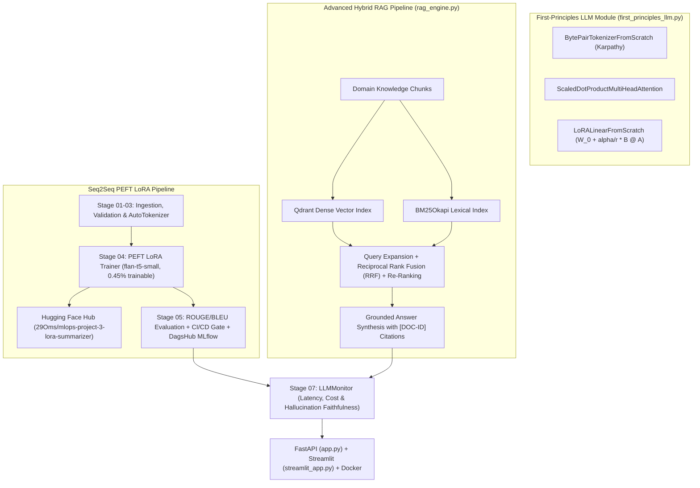

# Complete Step-by-Step Implementation Guide: Project 03 · NLP LoRA Fine-Tuning & Hybrid RAG System

> **Purpose of this Document**: This guide explains every step, mathematical equation, and critical code block used to build **Project 03** following Krish Naik's *End-to-End NLP Text Summarization Project*, Andrej Karpathy's *GPT & Tokenizer from Scratch*, Umar Jamil's *Attention & LoRA from Scratch*, and James Briggs's *Production RAG Series*.

---

## 1. System Architecture



---

## 2. Step-by-Step Code Walkthrough

### Step 1: First-Principles BPE, Self-Attention & LoRA (`components/first_principles_llm.py`)
Before touching Hugging Face `transformers` or `peft`, we implemented all three foundational mechanisms from scratch:
1. **`BytePairTokenizerFromScratch`**: Iteratively counts adjacent UTF-8 byte pairs and merges the top pair into new subword IDs $\ge 256$.
2. **`ScaledDotProductMultiHeadAttention`**: Splits $d_{\text{model}}$ across $h$ heads, applies scaled dot-product $\frac{QK^\top}{\sqrt{d_k}}$, masks future positions with $-\infty$ when `causal_mask=True`, and projects concatenated heads via $W_O$.
3. **`LoRALinearFromScratch`**: Freezes `self.pretrained.weight.requires_grad = False` and adds `lora_A` (Kaiming init) and `lora_B` (Zero init):
   ```python
   def forward(self, x: torch.Tensor) -> torch.Tensor:
       base_out = self.pretrained(x)
       lora_out = (self.dropout(x) @ self.lora_A.t() @ self.lora_B.t()) * self.scaling
       return base_out + lora_out
   ```

---

### Step 2: PEFT LoRA Fine-Tuning & Hugging Face Hub Push (`components/model_trainer.py`)
Using Hugging Face `peft`, we attach rank-$8$ LoRA adapters to the Query (`q`) and Value (`v`) attention projections of `google/flan-t5-small`:

```python
lora_config = LoraConfig(
    r=self.config.lora_r,               # 8
    lora_alpha=self.config.lora_alpha,   # 16
    target_modules=["q", "v"],
    lora_dropout=0.05,
    bias="none",
    task_type=TaskType.SEQ_2_SEQ_LM,
)
peft_model = get_peft_model(base_model, lora_config)
```

Only `344,064` parameters (`0.4451%`) require gradients! After training, adapter weights (`adapter_model.safetensors` & `adapter_config.json`) are saved locally and pushed to Hugging Face Hub (`29Oms/mlops-project-3-lora-summarizer`).

---

### Step 3: Quantitative Evaluation & CI/CD Gate (`components/model_evaluation.py`)
Computes `ROUGE-1`, `ROUGE-2`, `ROUGE-L`, `ROUGE-Lsum`, and `BLEU` for both the base model and the LoRA fine-tuned model, logs metrics to **DagsHub MLflow**, and writes `ci_cd_evaluation_gate_passed` to `artifacts/model_evaluation/evaluation_report.json`.

---

### Step 4: Hybrid RAG with Qdrant, BM25, RRF & Citations (`components/rag_engine.py`)
1. **Query Expansion**: Expands domain acronyms (`lora`, `rrf`, `ks`, `dvc`, `bpe`) before retrieval.
2. **Dual Indexing**: Stores normalized dense vectors in **Qdrant** (`QdrantClient`) and tokenized terms in **BM25Okapi**.
3. **Reciprocal Rank Fusion (RRF) & Re-Ranking**: Combines dense rank $r_{\text{dense}}$ and BM25 rank $r_{\text{bm25}}$ with query-document lexical overlap to rank the top-$K$ chunks and attach inline `[DOC-101]`..`[DOC-106]` citations.

---

### Step 5: LLM Hallucination & Telemetry Monitoring (`components/llm_monitor.py`)
Every API call records token usage, latency, estimated cost, and a **Faithfulness Grounding Score** in `artifacts/monitoring/llm_telemetry_logs.jsonl`.
